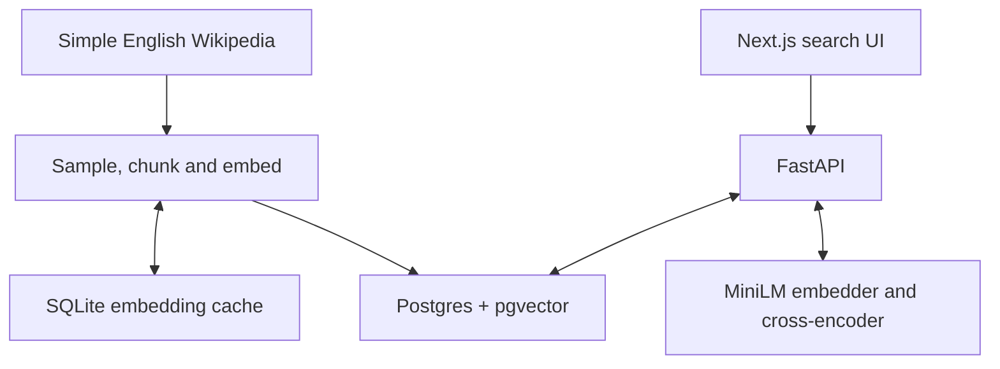

# WikiLens

WikiLens searches Simple English Wikipedia by article and shows the passage that matched. The Python FastAPI backend runs the embedding model and cross-encoder locally. The Next.js frontend calls FastAPI, and PostgreSQL with pgvector stores and ranks the passages.

## Retrieval evaluation

The project ships with **45 hand-labeled questions**. The evaluator writes the measured comparison to `benchmark/results.md` and `benchmark/results.json`. The JSON powers the Benchmark view and its precision comparison chart. The benchmark must run against an ingested corpus before these results are available.

| Mode | Ranking method | Metrics recorded per mode |
| --- | --- | --- |
| Keyword | PostgreSQL full-text rank | Precision@10, Recall@10, MRR@10, nDCG@10 |
| Semantic | MiniLM cosine similarity | Same test questions and metrics |
| Reranked | Semantic candidates ordered by a MiniLM cross-encoder | Same test questions and metrics |

The runner also measures cache-miss and cache-hit p50 and p95 latency. It warms model initialization outside the test set, rotates mode order, and times the retrieval service including database I/O on cache misses. These timings exclude HTTP transit, startup, and browser rendering.

The sampler includes available labeled articles so the benchmark measures retrieval over a corpus that contains the intended answers. The remaining articles come from a deterministic sample of the November 2023 dump. Each label is a known relevant article, and the labels are incomplete. Precision@10 can be at most 0.10 on a query with a single judged relevant article. A missing label is reported and queries without an available target are excluded, with a minimum of 30 matched queries required to publish a report. The same corpus fingerprint, questions, and judgments apply to all three modes.

## Run locally

Requires Python 3.12, Node.js 22+ with npm, internet access for initial downloads, and either Docker Desktop or a Supabase project.

### 1. Install Python dependencies

Windows PowerShell:

```powershell
py -3.12 -m venv .venv
.venv\Scripts\python.exe -m pip install torch==2.8.0 --index-url https://download.pytorch.org/whl/cpu
.venv\Scripts\python.exe -m pip install -r requirements-ingest.txt
Copy-Item .env.example .env
```

macOS or Linux:

```bash
python3.12 -m venv .venv
source .venv/bin/activate
pip install -r requirements-ingest.txt
cp .env.example .env
```

For the remaining Python commands on Windows, use `.venv\Scripts\python.exe` in place of `python` or activate the environment. The backend alone can install `requirements.txt`.

### 2. Set up PostgreSQL and pgvector

Local Docker:

```powershell
docker compose up -d --wait db
Get-Content -Raw db/schema.sql | docker compose exec -T db psql -U search -d search -v ON_ERROR_STOP=1
```

In a POSIX shell, use `docker compose exec -T db psql -U search -d search -v ON_ERROR_STOP=1 < db/schema.sql`.

For Supabase, run [db/schema.sql](db/schema.sql) in the Supabase SQL Editor and set the backend-only `DATABASE_URL` in `.env`. Use the direct connection when IPv6 is available or the **session pooler** for an IPv4 connection. Add `sslmode=require` to the managed connection URL. The session mode preserves the pgvector search path and other connection settings.

### 3. Load the corpus and run the benchmark

```text
python -m search.dataset --articles 5000
python -m search.ingest
python -m search.evaluate
```

The first run downloads the dataset and model weights. Ingestion stores vectors in `data/embeddings.sqlite3` by model revision and exact input text. Repeated runs reuse cached vectors, including overlapping records when the corpus scales from 5,000 to 50,000 articles. The import commits the document and passage snapshot together. Restart the API after changing the corpus to refresh its in-process cache.

### 4. Start the API and frontend

From the project directory:

```text
python -m uvicorn search.api:app --host 127.0.0.1 --port 8000
```

In a second terminal, enter `web`, copy `.env.example` to `.env.local`, and run:

```text
npm install
npm run dev
```

- Search UI at [localhost:3000](http://localhost:3000)
- FastAPI OpenAPI UI at [localhost:8000/docs](http://localhost:8000/docs)
- `GET /health` returns corpus counts.
- `GET /search?q=why+is+the+sky+blue&mode=reranked&page=1&page_size=8` returns ranked articles and timing. Modes are `keyword`, `semantic`, and `reranked`.
- `GET /benchmark` returns the generated report when its corpus fingerprint matches the running index.

## Architecture



- **Passages.** Tokenizer-aware windows reserve space for the article title and the model special tokens. MiniLM allows 256 input tokens. Full windows typically contain about 200–250 passage tokens, with 32 tokens of overlap. Source text is kept for snippets.
- **Retrieval.** HNSW retrieves up to 200 matching passages and keeps the best passage per article. The service falls back to exact similarity when the passage candidates contain fewer than 50 distinct articles. Reranking scores the best passage for each of the 50 semantic article candidates. Keyword mode uses a weighted English GIN full-text index and selects the best matching source passage.
- **Serving.** FastAPI validates queries, loads the pinned models on startup, uses a bounded Postgres connection pool, and caches up to 512 full rankings per worker for five minutes. Pagination slices the same 50-article ranking window. Displayed scores are method-specific.
- **Scaling.** Use `python -m search.dataset --articles 50000` and rerun ingestion to expand locally. Database size depends on passage count and index overhead. Check `pg_database_size(current_database())` against the managed tier before importing the larger index.

## Deployment

1. Create the Supabase schema and index the corpus using its session connection. Run the benchmark against the intended production corpus.
2. Deploy the root Dockerfile to a Python host such as Railway or Render. Set `DATABASE_URL` and a private `SEARCH_API_TOKEN`. Configure the health check at `/health` and allow startup time to load both models. Keep `benchmark/results.json` in the build context to serve the measured report.
3. Import the same project into Vercel with `web` as its root directory. Set server-side `SEARCH_API_URL` to the hosted FastAPI URL and `SEARCH_API_TOKEN` to the same backend token. Next.js forwards the token from the server so browsers interact only with the first-party route.

## Checks and demo recording

```text
python -m unittest discover -s tests -v
python -m compileall -q search tests
```

Use `npm run build` from `web` for the production build and `npm run typecheck` for TypeScript checking. With both services running, generate `benchmark/demo.gif` from the live UI:

```text
python -m pip install playwright pillow
python -m playwright install chromium
python scripts/record_demo.py
```

## Sources

Articles are from [Simple English Wikipedia contributors](https://simple.wikipedia.org/), distributed through the [Wikimedia Wikipedia dataset](https://huggingface.co/datasets/wikimedia/wikipedia) with source links on each result. See the dataset card and [Wikimedia terms](https://foundation.wikimedia.org/wiki/Policy:Terms_of_Use) for attribution and the applicable CC BY-SA terms. Embedding and reranking use [all-MiniLM-L6-v2](https://huggingface.co/sentence-transformers/all-MiniLM-L6-v2) and [ms-marco-MiniLM-L6-v2](https://huggingface.co/cross-encoder/ms-marco-MiniLM-L6-v2).

