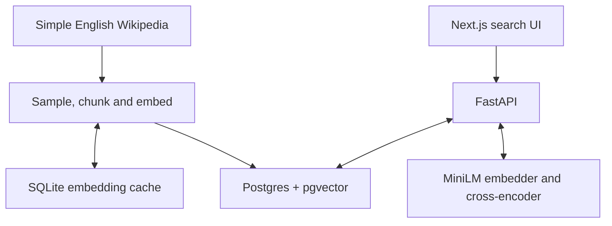

# WikiLens

WikiLens searches Simple English Wikipedia by article and shows the passage that matched. The Python FastAPI backend runs the embedding model and cross-encoder locally. The Next.js frontend calls FastAPI, and PostgreSQL with pgvector stores and ranks the passages.

## Retrieval evaluation

The project ships with **45 hand-labeled questions**. The evaluator writes the measured comparison to `benchmark/results.md` and `benchmark/results.json`. The JSON powers the Benchmark view and its precision comparison chart. The benchmark must run against an ingested corpus before these results are available.

| Mode | Ranking method | Metrics recorded per mode |
| --- | --- | --- |
| Keyword | PostgreSQL full-text rank | Precision@10, Recall@10, MRR@10, nDCG@10 |
| Semantic | MiniLM cosine similarity | Same test questions and metrics |
| Reranked | Semantic candidates ordered by a MiniLM cross-encoder | Same test questions and metrics |

The runner also measures cache-miss and cache-hit p50 and p95 latency. It warms model initialization outside the test set, rotates mode order, and times the retrieval service including database I/O on cache misses. These timings exclude HTTP transit, startup, and browser rendering.

The sampler includes available labeled articles so the benchmark measures retrieval over a corpus that contains the intended answers. The remaining articles come from a deterministic sample of the November 2023 dump. Each label is a known relevant article, and the labels are incomplete. Precision@10 can be at most 0.10 on a query with a single judged relevant article. A missing label is reported and queries without an available target are excluded, with a minimum of 30 matched queries required to publish a report. The same corpus fingerprint, questions, and judgments apply to all three modes.

## Run locally

Requires Python 3.12, Node.js 22+ with npm, internet access for initial downloads, and either Docker Desktop or a Supabase project.

### 1. Install Python dependencies

Windows PowerShell:

```powershell
py -3.12 -m venv .venv
.venv\Scripts\python.exe -m pip install torch==2.8.0 --index-url https://download.pytorch.org/whl/cpu
.venv\Scripts\python.exe -m pip install -r requirements-ingest.txt
Copy-Item .env.example .env
```

macOS or Linux:

```bash
python3.12 -m venv .venv
source .venv/bin/activate
pip install -r requirements-ingest.txt
cp .env.example .env
```

For the remaining Python commands on Windows, use `.venv\Scripts\python.exe` in place of `python` or activate the environment. The backend alone can install `requirements.txt`.

### 2. Set up PostgreSQL and pgvector

Local Docker:

```powershell
docker compose up -d --wait db
Get-Content -Raw db/schema.sql | docker compose exec -T db psql -U search -d search -v ON_ERROR_STOP=1
```

In a POSIX shell, use `docker compose exec -T db psql -U search -d search -v ON_ERROR_STOP=1 < db/schema.sql`.

For Supabase, run [db/schema.sql](db/schema.sql) in the Supabase SQL Editor and set the backend-only `DATABASE_URL` in `.env`. Use the direct connection when IPv6 is available or the **session pooler** for an IPv4 connection. Add `sslmode=require` to the managed connection URL. The session mode preserves the pgvector search path and other connection settings.

### 3. Load the corpus and run the benchmark

```text
python -m search.dataset --articles 5000
python -m search.ingest
python -m search.evaluate
```

The first run downloads the dataset and model weights. Ingestion stores vectors in `data/embeddings.sqlite3` by model revision and exact input text. Repeated runs reuse cached vectors, including overlapping records when the corpus scales from 5,000 to 50,000 articles. The API uses a fresh cache namespace after each index activation.

### 4. Start the API and frontend

From the project directory:

```text
python -m uvicorn search.api:app --host 127.0.0.1 --port 8000
```

In a second terminal, enter `web`, copy `.env.example` to `.env.local`, and run:

```text
npm install
npm run dev
```

- Search UI at [localhost:3000](http://localhost:3000)
- FastAPI OpenAPI UI at [localhost:8000/docs](http://localhost:8000/docs)
- `GET /health` returns corpus counts.
- `GET /search?q=why+is+the+sky+blue&mode=reranked&page=1&page_size=8` returns ranked articles and timing. Modes are `keyword`, `semantic`, and `reranked`.
- `GET /benchmark` returns the generated report when its corpus fingerprint matches the running index.

## Search under load

The CPU cross-encoder processes one ranking at a time. When its slot is busy, a new first-page reranked search can return semantic results from pgvector. This follows the priority model in [Netflix's service-level load shedding write-up](https://netflixtechblog.com/enhancing-netflix-reliability-with-service-level-prioritized-load-shedding-e735e6ce8f7d), with search treated as essential and reranking as optional. The protection is per worker, and embedding and database capacity still limit throughput.

`mode` reports the requested ranking and `effective_mode` reports the ranking actually served. The UI labels semantic fallback and uses `effective_mode` with `allow_fallback=false` for page navigation. This keeps the ranking method consistent if a cached result expires. Cached reranked results remain eligible during busy periods.

With a local corpus, compare `SEARCH_SHED_RERANKING=0` and `SEARCH_SHED_RERANKING=1`. Restart the single-worker API with each setting, make one warm-up query outside the benchmark set, then run the same cold-cache burst once per restart.

```text
python scripts/benchmark_overload.py --requests 16
```

The report shows the number of requests served by each mode, errors, and p95 HTTP latency among successful responses. Check the cache-hit count before comparing runs. The retrieval quality benchmark continues to evaluate each mode independently.

## Contextual retrieval and recovery

The `plain` profile embeds each passage with its title. The `contextual` profile also supplies a short extract from the article opening to later passages. It uses the source text as context and reserves room in the model's token budget. The UI still shows the original passage. This adapts the contextual embeddings idea from [Anthropic's retrieval write-up](https://www.anthropic.com/research/contextual-retrieval).

Use the same corpus and labeled questions for both profiles to measure the Recall@10 and latency tradeoffs.

```text
python -m search.ingest --profile plain
python -m search.evaluate --profile plain --output benchmark/comparison/plain.json
python -m search.ingest --profile contextual
python -m search.evaluate --profile contextual --output benchmark/comparison/contextual.json
python scripts/compare_benchmarks.py benchmark/comparison/plain.json benchmark/comparison/contextual.json
```

The database retains the previous snapshot when a different corpus or profile is activated. Ingestion checks the candidate's row counts, document coverage, and vectors before committing. If validation fails, the active index stays in service. If a candidate passes those checks and later performs poorly, restore the previous snapshot with `python -m search.ingest --rollback`. This applies the [last-known-good approach used by Cloudflare](https://blog.cloudflare.com/code-orange-fail-small-complete/). `/health` reports the live profile and document count. `/benchmark` serves a report for the active corpus and profile.

## Performance regression checks

The pull request workflow evaluates the base revision and the candidate against the same plain index and labeled questions on one runner. It reports Recall@10 and cache-miss p95 for each mode. The check fails if any mode's p95 increases by more than the greater of **25% or 15 ms**. The workflow also saves both HTTP burst reports, publishes a plain-versus-contextual comparison, and verifies recovery against its disposable database. The comparison follows the regression-detection idea in [OpenAI's Performance Factory write-up](https://openai.com/index/how-openai-performance-factory-keeps-chatgpt-fast/).

## Architecture



- **Passages.** Tokenizer-aware windows reserve space for the article title and the model special tokens. MiniLM allows 256 input tokens. Full windows typically contain about 200–250 passage tokens, with 32 tokens of overlap. Source text is kept for snippets.
- **Retrieval.** HNSW retrieves up to 200 matching passages and keeps the best passage per article. The service falls back to exact similarity when the passage candidates contain fewer than 50 distinct articles. Reranking scores the best passage for each of the 50 semantic article candidates. Keyword mode uses a weighted English GIN full-text index and selects the best matching source passage.
- **Serving.** FastAPI validates queries, loads the pinned models on startup, uses a bounded Postgres connection pool, and caches up to 512 full rankings per worker for five minutes. Pagination slices the same 50-article ranking window. Displayed scores are method-specific.
- **Scaling.** Use `python -m search.dataset --articles 50000` and rerun ingestion to expand locally. Database size depends on passage count and index overhead. Check `pg_database_size(current_database())` against the managed tier before importing the larger index.

## Deployment

1. Apply [db/schema.sql](db/schema.sql) to the database before deploying this API or running ingestion. The schema upgrade preserves an existing live index. Index the corpus using Supabase's session connection and run the benchmark against the intended production corpus and profile.
2. Deploy the root Dockerfile to a Python host such as Railway or Render. Set `DATABASE_URL` and a private `SEARCH_API_TOKEN`. Configure the health check at `/health` and allow startup time to load both models. Keep `benchmark/results.json` in the build context to serve the measured report.
3. Import the same project into Vercel with `web` as its root directory. Set server-side `SEARCH_API_URL` to the hosted FastAPI URL and `SEARCH_API_TOKEN` to the same backend token. Next.js forwards the token from the server so browsers interact only with the first-party route.

## Checks and demo recording

```text
python -m unittest discover -s tests -v
python -m compileall -q search tests
```

Use `npm run build` from `web` for the production build and `npm run typecheck` for TypeScript checking. With both services running, generate `benchmark/demo.gif` from the live UI:

```text
python -m pip install playwright pillow
python -m playwright install chromium
python scripts/record_demo.py
```

## Sources

Articles are from [Simple English Wikipedia contributors](https://simple.wikipedia.org/), distributed through the [Wikimedia Wikipedia dataset](https://huggingface.co/datasets/wikimedia/wikipedia) with source links on each result. See the dataset card and [Wikimedia terms](https://foundation.wikimedia.org/wiki/Policy:Terms_of_Use) for attribution and the applicable CC BY-SA terms. Embedding and reranking use [all-MiniLM-L6-v2](https://huggingface.co/sentence-transformers/all-MiniLM-L6-v2) and [ms-marco-MiniLM-L6-v2](https://huggingface.co/cross-encoder/ms-marco-MiniLM-L6-v2).

